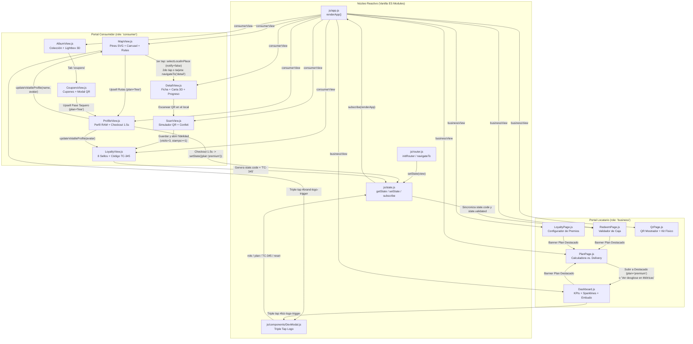

# TacoCards Tijuana — Contexto Arquitectónico, Funcional e Interconexiones (`CONTEXT.md`)

Documento de referencia técnica integral del proyecto **TacoCards Tijuana**. Describe la arquitectura actual de la aplicación web progresiva (PWA), la estructura de archivos, el catálogo comentado de todas las funciones por módulo, las interconexiones reactivas entre interfaces (**Consumidor ↔ Estado ↔ Locatario**) y los hallazgos/preguntas clave para guiar el desarrollo.

---

## 1. Visión General y Filosofía Arquitectónica

**TacoCards Tijuana** es una PWA _mobile-first_ de descubrimiento gastronómico local, coleccionismo digital de cartas (_trading cards_ con efecto holográfico 3D) y fidelización de clientes para negocios independientes de Tijuana.

### Principios Técnicos Actuales

- **Zero-Framework Vanilla ES Modules:** Sin bundlers ni dependencias de runtime (`package.json` ausente por diseño). Todo el código se ejecuta directamente en el navegador mediante `<script type="module" src="js/app.js"></script>`.
- **Estado Reactivo Observable + Persistencia Selectiva:** Un único store en `js/state.js` (~120 líneas) sincroniza el estado de negocio en `localStorage` (`tacocards_state_v1`), manteniendo deliberadamente el perfil del usuario (`userProfile`) en **memoria RAM volátil** para que cada recarga inicie limpia en modo invitado durante demostraciones (_pitch_).
- **Doble Portal Unificado (`role: 'consumer' | 'business'`):** La misma SPA aloja tanto la experiencia del comensal como el portal administrativo del locatario, compartiendo estado en vivo (por ejemplo, un código `TC-345` generado por el consumidor puede validarse inmediatamente en la vista de caja del locatario).
- **Doble Nivel de Monetización (`plan: 'free' | 'premium'`):**
  - En modo **Consumidor**, `premium` representa el **Pase Taquero ($39 MXN/mes)** (desbloquea Rutas por Colonia, carta legendaria _Taco de Oro #001/200_ y Cuponera).
  - En modo **Locatario**, `premium` representa el **Plan Destacado ($249 MXN/mes)** (desbloquea KPIs avanzados, gráficas de retención/embudo/ROI, validador de canjes en caja y editor de programa de fidelidad).

---

## 2. Estructura Completa del Proyecto

```text
Tacocards Tijuana/
├── index.html                        # Shell HTML5 PWA, carga fuentes (Cinzel + Manrope) y monta #app
├── manifest.json                     # Web App Manifest (standalone, portrait, iconos SVG inline)
├── sw.js                             # Service Worker (Network-first para HTML, Cache-first para assets)
├── vercel.json                       # Configuración de despliegue estático (cleanUrls + rewrite SPA a /index.html)
├── test_modules.js                   # Suite de verificación con node:assert (datos, iconos, estado, matemáticas)
├── .graphifyignore                   # Exclusión de .agents/ y skills-lock.json para limpieza del grafo
├── css/
│   └── style.css                     # Sistema de diseño completo, tokens CSS, layout móvil, cartas 3D y modales
├── js/
│   ├── app.js                        # Orquestador principal: registra SW, inicia router y suscribe renderApp()
│   ├── state.js                      # Store reactivo observable + persistencia en localStorage + perfil volátil
│   ├── router.js                     # Enrutador basado en History API (pushState, replaceState, popstate)
│   ├── data/
│   │   └── mockData.js               # Catálogo estático: 6 locales, 1 Taco de Oro, rarezas, cupones y KPIs
│   ├── components/
│   │   ├── Icon.js                   # Diccionario de 27 iconos SVG vectoriales inline (UI + gastronomía)
│   │   ├── Button.js                 # Generador de botones táctiles (variantes primary, outline, quiet, teal)
│   │   ├── TradingCard.js            # Carta coleccionable 3D con giroscopio, pointer tilt, flip y QR reverso
│   │   ├── FakeQR.js                 # Generador determinista de matriz QR decorativa 9×9 (81 celdas)
│   │   └── DevModal.js               # Menú secreto "Pitch Control" activado por triple toque en el logo
│   └── views/
│       ├── consumer/
│       │   ├── ConsumerNav.js        # Barra inferior de 4 pestañas (Mapa, Álbum, Fidelidad, Perfil)
│       │   ├── MapView.js            # Mapa claro de Tijuana, pines SVG, filtros, rutas y carrusel inferior
│       │   ├── DetailView.js         # Ficha de local, platillos destacados, carta interactiva y barra de visitas
│       │   ├── ScanView.js           # Simulador de cámara QR con verificación GPS y revelación con confeti
│       │   ├── AlbumView.js          # Colección de cartas, filtros/ordenamiento, Lightbox 3D y Web Share
│       │   ├── CouponsView.js        # Sub-vista de cupones (bloqueo Free vs. modal de canje QR en Premium)
│       │   ├── LoyaltyView.js        # Tarjeta de 8 sellos, simulador secuencial (+1 visita) y pantalla pasiva
│       │   └── ProfileView.js        # Perfil volátil editable en RAM, logros y pasarela simulada (1.5s)
│       └── business/
│           ├── BusinessNav.js        # Barra inferior de 5 pestañas (Métricas, Canjes, Fidelidad, Mi QR, Plan)
│           ├── Dashboard.js          # Resumen de rendimiento, 5 KPIs con sparklines y 4 tarjetas analíticas
│           ├── RedeemPage.js         # Validador de códigos en mostrador sincronizado con state.code
│           ├── LoyaltyPage.js        # Configurador de reglas y premios de sellos 4 y 8 para el negocio
│           ├── QrPage.js             # Código QR oficial del local y solicitud de kit físico de mostrador
│           └── PlanPage.js           # Comparador Gratuito vs. Destacado y calculadora contra apps de reparto
├── md/
│   ├── AGENT.md                      # Especificación arquitectónica base y prototipo monolítico de referencia
│   └── design.md                     # Hoja de ruta y requerimientos de Fase 4 (UI/UX y lógica de negocio)
└── graphify-out/
    ├── graph.html                    # Visualización interactiva del grafo de conocimiento (122 nodos, 454 aristas)
    ├── GRAPH_REPORT.md               # Reporte de auditoría estructural, comunidades y nodos centrales (God Nodes)
    └── graph.json                    # Grafo serializado para consultas GraphRAG
```

---

## 3. Modelo de Estado Global (`js/state.js`)

El estado en memoria (`currentState`) combina datos persistidos en `localStorage` bajo la clave `'tacocards_state_v1'` con un sub-objeto volátil `userProfile`.

| Propiedad         | Tipo                                                               | Valor Inicial                                   | Persistencia   | Propósito y Vistas que la Consumen                                                                                     |
| :---------------- | :----------------------------------------------------------------- | :---------------------------------------------- | :------------- | :--------------------------------------------------------------------------------------------------------------------- |
| `role`            | `'consumer' \| 'business'`                                         | `'consumer'`                                    | `localStorage` | Define qué portal renderiza `app.js` y cómo enruta `router.js`. Se alterna desde `DevModal.js`.                        |
| `plan`            | `'free' \| 'premium'`                                              | `'free'`                                        | `localStorage` | Controla candados y beneficios tanto en Consumidor (Pase Taquero) como en Locatario (Plan Destacado).                  |
| `theme`           | `'light' \| 'dark'`                                                | `'light'`                                       | `localStorage` | Sistema de temas accesible (Modo Claro y Modo Oscuro) sincronizado con `document.documentElement[data-theme]`.         |
| `consumerView`    | `'map' \| 'detail' \| 'scan' \| 'album' \| 'loyalty' \| 'profile'` | `'map'`                                         | `localStorage` | Vista activa del portal Consumidor. Oculta `ConsumerNav` cuando vale `'detail'` o `'scan'`.                            |
| `businessView`    | `'dashboard' \| 'redeem' \| 'business-loyalty' \| 'qr' \| 'plan'`  | `'dashboard'`                                   | `localStorage` | Vista activa del portal Locatario.                                                                                     |
| `selectedLocalId` | `number`                                                           | `1`                                             | `localStorage` | ID del local seleccionado (`1` a `6`). Conecta `MapView.js` $\rightarrow$ `DetailView.js` $\rightarrow$ `ScanView.js`. |
| `visits`          | `number`                                                           | `2`                                             | `localStorage` | Contador secuencial de visitas. Al llegar a `>= 3`, desbloquea la tarjeta de sellos en `DetailView` y `LoyaltyView`.   |
| `stamps`          | `number`                                                           | `1`                                             | `localStorage` | Sellos acumulados (`0` a `8`). Calculado como `Math.min(8, Math.max(1, newVisits - 2))` a partir de la 3ª visita.      |
| `code`            | `string`                                                           | `''`                                            | `localStorage` | Código temporal de premio (ej. `'TC-345'`). Generado en `LoyaltyView`/`DevModal` y validado en `RedeemPage`.           |
| `codeExpires`     | `number \| null`                                                   | `null`                                          | `localStorage` | Timestamp de expiración (`Date.now() + 600000`, 10 min) al reclamar premio en `LoyaltyView`.                           |
| `validated`       | `boolean`                                                          | `false`                                         | `localStorage` | Marca si `state.code` ya fue canjeado en `RedeemPage.js` para impedir doble uso.                                       |
| `unlockedCardIds` | `number[]`                                                         | `[1, 2, 3, 4]`                                  | `localStorage` | IDs de cartas desbloqueadas en `AlbumView.js` y contabilizadas en `ProfileView.js`.                                    |
| `albumSortOrder`  | `'recent' \| 'rarity' \| 'name'`                                   | `'recent'`                                      | `localStorage` | Criterio activo del selector de ordenamiento en `AlbumView.js`.                                                        |
| `userProfile`     | `{ name, avatar, level, isRegistered }`                            | `'Usuario no registrado'`, `'TC'`, `1`, `false` | **Solo RAM**   | Datos de sesión editables en `ProfileView.js` y leídos en el saludo de `MapView.js` e ID de `LoyaltyView.js`.          |

---

## 4. Catálogo Comentado de Funciones por Módulo

### 4.1 Núcleo (`js/app.js`, `js/state.js`, `js/router.js`, `sw.js`)

```javascript
// ============================================================================
// js/app.js — Orquestador Raíz
// ============================================================================

/**
 * Registra el Service Worker (/sw.js) cuando la app corre sobre HTTP/HTTPS.
 * Falla de forma silenciosa con console.warn en entornos locales restringidos.
 */
function registerServiceWorker()

/**
 * Función maestra de renderizado montada sobre #app.
 * 1. Limpia #app y lee getState().
 * 2. Crea div.mobile-pwa-root con clase dinámica `${state.role}-mode`.
 * 3. Si role === 'consumer': monta la vista según state.consumerView y agrega
 *    createConsumerNav() excepto en las vistas inmersivas ('detail' y 'scan').
 * 4. Si role === 'business': monta la vista según state.businessView y agrega
 *    siempre createBusinessNav().
 */
function renderApp()

// ============================================================================
// js/state.js — Store Observable y Acciones de Dominio
// ============================================================================

/**
 * Carga DEFAULT_STATE fusionado con localStorage['tacocards_state_v1'],
 * pero fuerza siempre userProfile a DEFAULT_VOLATILE_PROFILE en RAM.
 */
function loadInitialState()

/**
 * Persiste currentState en localStorage excluyendo explícitamente userProfile
 * mediante desestructuración: const { userProfile, ...persisted } = currentState.
 */
function saveState()

/** Devuelve la referencia actual al estado en memoria. */
export function getState()

/**
 * Fusiona updates en currentState, persiste en localStorage y notifica a los
 * suscriptores si notify === true.
 * Nota clave: MapView y AlbumView pasan notify = false para actualizaciones
 * locales in-place sin disparar renderApp() global.
 */
export function setState(updates, notify = true)

/**
 * Actualiza únicamente currentState.userProfile en RAM (sin llamar a saveState)
 * y notifica a los listeners registrados.
 */
export function updateVolatileProfile(profileUpdates)

/**
 * Avanza secuencialmente (+1) el contador de visitas:
 * - Si newVisits < 3: mantiene stamps = 0.
 * - Si newVisits >= 3: asegura que el local 1 esté en unlockedCardIds y calcula
 *   newStamps = Math.min(8, Math.max(1, newVisits - 2)).
 */
export function incrementVisit()

/** Reinicia visitas, sellos y estado de código de canje a cero. */
export function resetVisits()

/** Restaura tanto DEFAULT_STATE como DEFAULT_VOLATILE_PROFILE para reiniciar el pitch. */
export function resetDemoState()

/** Registra un listener reactivo y devuelve su función de desuscripción. */
export function subscribe(fn)

// ============================================================================
// js/router.js — Enrutador History API
// ============================================================================

/**
 * Escucha window 'popstate' para sincronizar el botón Atrás/Adelante del
 * navegador o teléfono con state.consumerView / state.businessView, evitando
 * bucles de pushState mediante la bandera isNavigatingFromPopState.
 */
export function initRouter()

/**
 * Cambia la vista activa según el rol actual y registra la entrada en
 * window.history.pushState (ej. '#/local/1' para detalle o '#/album').
 */
export function navigateTo(view, params = {})
```

---

### 4.2 Componentes Reutilizables (`js/components/`)

| Archivo                                                                                                                      | Función                                                                                                                                                                                                                                                                       | Comentario Técnico de Operación e Interconexión                                                                                                                                                                                                                                                                                                                                |
| :--------------------------------------------------------------------------------------------------------------------------- | :---------------------------------------------------------------------------------------------------------------------------------------------------------------------------------------------------------------------------------------------------------------------------- | :----------------------------------------------------------------------------------------------------------------------------------------------------------------------------------------------------------------------------------------------------------------------------------------------------------------------------------------------------------------------------- |
| [Icon.js](file:///D:/7mo%20Semestre/Desarrollo%20de%20Emprendedores/Tacocards%20Tijuana/js/components/Icon.js)               | [`getIconSvg(name, size)`](file:///D:/7mo%20Semestre/Desarrollo%20de%20Emprendedores/Tacocards%20Tijuana/js/components/Icon.js#L37-L40)                                                                                                                                       | **God Node #1 del grafo (45 conexiones).** Devuelve un `<svg>` inline con `stroke="currentColor"`. Incluye 22 iconos de interfaz y 5 iconos gastronómicos semánticos (`taco`, `fish`, `goat`, `dessert`, `cutlery`) usados en los pines del mapa.                                                                                                                              |
| [Icon.js](file:///D:/7mo%20Semestre/Desarrollo%20de%20Emprendedores/Tacocards%20Tijuana/js/components/Icon.js)               | [`createIcon(name, size)`](file:///D:/7mo%20Semestre/Desarrollo%20de%20Emprendedores/Tacocards%20Tijuana/js/components/Icon.js#L42-L46)                                                                                                                                       | Envuelve `getIconSvg()` para devolver directamente un nodo `SVGSVGElement` del DOM.                                                                                                                                                                                                                                                                                            |
| [Button.js](file:///D:/7mo%20Semestre/Desarrollo%20de%20Emprendedores/Tacocards%20Tijuana/js/components/Button.js)           | [`createButton(opts)`](file:///D:/7mo%20Semestre/Desarrollo%20de%20Emprendedores/Tacocards%20Tijuana/js/components/Button.js#L4-L28)                                                                                                                                          | Construye un `HTMLButtonElement` accesible (`min-height: 56px`, tipografía `16.5px`, `iconSize: 22`) con variantes `primary`, `outline`, `quiet`, `teal`. Usado en `DetailView` y `ScanView`.                                                                                                                                                                                  |
| [FakeQR.js](file:///D:/7mo%20Semestre/Desarrollo%20de%20Emprendedores/Tacocards%20Tijuana/js/components/FakeQR.js)           | [`createFakeQR(opts)`](file:///D:/7mo%20Semestre/Desarrollo%20de%20Emprendedores/Tacocards%20Tijuana/js/components/FakeQR.js#L4-L46)                                                                                                                                          | Genera una cuadrícula `.fake-qr` determinista de 81 celdas (9×9) con espacio central reservado para incrustar el emblema del negocio o de TacoCards (`.qr-center-logo` con icono, siglas y sub-etiqueta). Usado en `TradingCard`, `LoyaltyView`, `CouponsView` y `QrPage`.                                                                                                   |
| [TradingCard.js](file:///D:/7mo%20Semestre/Desarrollo%20de%20Emprendedores/Tacocards%20Tijuana/js/components/TradingCard.js) | [`initGyroscope()`](file:///D:/7mo%20Semestre/Desarrollo%20de%20Emprendedores/Tacocards%20Tijuana/js/components/TradingCard.js#L10-L34)                                                                                                                                       | Registra una única vez (`gyroActive`) el listener `deviceorientation` pasivo en `window`. Convierte ángulos `gamma` y `beta` en variables CSS `--rx`, `--ry`, `--mx`, `--my` sobre todas las cartas `.collectible:not(.locked)` para el brillo holográfico `.foil`.                                                                                                            |
| [TradingCard.js](file:///D:/7mo%20Semestre/Desarrollo%20de%20Emprendedores/Tacocards%20Tijuana/js/components/TradingCard.js) | [`createTradingCard(opts)`](file:///D:/7mo%20Semestre/Desarrollo%20de%20Emprendedores/Tacocards%20Tijuana/js/components/TradingCard.js#L36-L161)                                                                                                                              | Renderiza la carta coleccionable de 2 caras (`.card-front` con foto, rareza, blurb y stats `[Sabor, Fama, Visitas]`; `.card-back` con historia del fundador, horario, dirección y mini QR). Soporta modo `locked`, `compact`, `preview` y callback `onActivate` (para abrir Lightbox desde el Álbum en vez de girar in-place). Incluye fallback `pointermove` para escritorio. |
| [DevModal.js](file:///D:/7mo%20Semestre/Desarrollo%20de%20Emprendedores/Tacocards%20Tijuana/js/components/DevModal.js)       | [`initDevModalTrigger(logoEl)`](file:///D:/7mo%20Semestre/Desarrollo%20de%20Emprendedores/Tacocards%20Tijuana/js/components/DevModal.js#L7-L26)                                                                                                                               | Detecta **3 toques en menos de 700 ms** sobre el logotipo `.screen-brand` (en `MapView` o `Dashboard`) e invoca `openDevModal()`.                                                                                                                                                                                                                                              |
| [DevModal.js](file:///D:/7mo%20Semestre/Desarrollo%20de%20Emprendedores/Tacocards%20Tijuana/js/components/DevModal.js)       | [`openDevModal()`](file:///D:/7mo%20Semestre/Desarrollo%20de%20Emprendedores/Tacocards%20Tijuana/js/components/DevModal.js#L28-L126) / [`closeDevModal()`](file:///D:/7mo%20Semestre/Desarrollo%20de%20Emprendedores/Tacocards%20Tijuana/js/components/DevModal.js#L128-L133) | Monta en `document.body` el panel "Pitch Control" que permite cambiar instantáneamente `role` (`consumer`/`business`), `plan` (`free`/`premium`), saltar a 3 visitas desbloqueadas, inyectar el código `TC-345` o ejecutar `resetDemoState()`.                                                                                                                                 |

---

### 4.3 Vistas del Portal Consumidor (`js/views/consumer/`)

#### 1. [`MapView.js`](file:///D:/7mo%20Semestre/Desarrollo%20de%20Emprendedores/Tacocards%20Tijuana/js/views/consumer/MapView.js) — Mapa Interactivo y Descubrimiento

- [`getLocalFoodIcon(loc)`](file:///D:/7mo%20Semestre/Desarrollo%20de%20Emprendedores/Tacocards%20Tijuana/js/views/consumer/MapView.js#L12-L22): Resuelve el icono SVG semántico de cada pin según `loc.art` o palabras clave en `loc.type` (`taquer` $\rightarrow$ `taco`, `birri` $\rightarrow$ `goat`, `marisc` $\rightarrow$ `fish`, `reposter` $\rightarrow$ `dessert`, fallback $\rightarrow$ `cutlery`).
- [`renderMapView()`](file:///D:/7mo%20Semestre/Desarrollo%20de%20Emprendedores/Tacocards%20Tijuana/js/views/consumer/MapView.js#L24-L290):
  - Saluda dinámicamente usando el primer nombre de `state.userProfile.name` (o `'Alex'` si sigue como `'Usuario no registrado'`).
  - Filtra `locals` por categoría (`Todos`, `Tacos`, `Birria`, `Mariscos`, `Postres`).
  - Dibuja el lienzo `.tijuana-map` con zonas (`Zona Río`, `Centro`, `Av. Revolución`), vialidades (`.road`), capa SVG de rutas premium (`.routes-svg-layer`) y pines posicionados por porcentaje (`coords.x%`, `coords.y%`).
  - Renderiza el botón `.routes-button`: en plan `free` abre el modal de upsell `#routes-upsell-modal` (cuyo CTA navega a `profile`); en plan `premium` activa/desactiva el trazado de ruta sobre el mapa.
  - Renderiza la tarjeta flotante `#map-place-card` y el carrusel horizontal `#discover-carousel`.
- [`buildPlaceCardHtml(local)`](file:///D:/7mo%20Semestre/Desarrollo%20de%20Emprendedores/Tacocards%20Tijuana/js/views/consumer/MapView.js#L41-L57): Genera el HTML interior de la tarjeta inferior de previsualización del local activo.
- [`selectLocalInPlace(localId)`](file:///D:/7mo%20Semestre/Desarrollo%20de%20Emprendedores/Tacocards%20Tijuana/js/views/consumer/MapView.js#L175-L204): **Optimización clave de reactividad (<50ms).** Al tocar un pin o tarjeta del carrusel que no estaba seleccionado, llama a `setState({ selectedLocalId: localId }, false)` (silencioso, sin destruir el árbol DOM), actualiza `.selected` en los pines, reemplaza solo el interior de `#map-place-card` y centra suavemente (`scrollIntoView`) la tarjeta activa del carrusel. Si el usuario vuelve a tocar el pin o tarjeta ya seleccionado, navega a `detail` (`navigateTo('detail', { localId })`).

#### 2. [`DetailView.js`](file:///D:/7mo%20Semestre/Desarrollo%20de%20Emprendedores/Tacocards%20Tijuana/js/views/consumer/DetailView.js) — Ficha del Negocio

- [`renderDetailView()`](file:///D:/7mo%20Semestre/Desarrollo%20de%20Emprendedores/Tacocards%20Tijuana/js/views/consumer/DetailView.js#L9-L117):
  - Toma el local correspondiente a `state.selectedLocalId` y sus metadatos de `cardDetails[local.id]`.
  - Muestra foto de portada, botón de regreso (`history.back()` o `navigateTo('map')`), horario, dirección y píldoras de menú.
  - Incrusta una instancia interactiva de `createTradingCard({ local, compact: true, preview: false })` que gira al tocarla.
  - Muestra barra de progreso inicial (`Visita X/3`) si `state.visits < 3`, o fila de 8 sellos (`state.stamps de 8 sellos`) si `state.visits >= 3`.
  - Fija en la parte inferior el botón primario `"Escanear QR en el local"` que ejecuta `navigateTo('scan')`.

#### 3. [`ScanView.js`](file:///D:/7mo%20Semestre/Desarrollo%20de%20Emprendedores/Tacocards%20Tijuana/js/views/consumer/ScanView.js) — Escáner Simulado y Revelación de Carta

- [`renderScanView()`](file:///D:/7mo%20Semestre/Desarrollo%20de%20Emprendedores/Tacocards%20Tijuana/js/views/consumer/ScanView.js#L9-L117) y su clausura interna [`render()`](file:///D:/7mo%20Semestre/Desarrollo%20de%20Emprendedores/Tacocards%20Tijuana/js/views/consumer/ScanView.js#L17-L113):
  - **Estado 1 (`revealed = false`):** Muestra visor de cámara simulado con marco de escaneo, insignia `"Ubicación GPS verificada · En el local"` y botón `"Simular escaneo de QR"`.
  - **Estado 2 (`revealed = true`):** Dispara 24 partículas de confeti CSS, revela la `TradingCard` a tamaño completo (`+120 pts`) y presenta el botón `"Guardar y abrir fidelidad"`, que actualiza `setState({ visits: 3, stamps: Math.max(1, state.stamps), consumerView: 'loyalty' })` y navega a `loyalty`.

#### 4. [`AlbumView.js`](file:///D:/7mo%20Semestre/Desarrollo%20de%20Emprendedores/Tacocards%20Tijuana/js/views/consumer/AlbumView.js) y [`CouponsView.js`](file:///D:/7mo%20Semestre/Desarrollo%20de%20Emprendedores/Tacocards%20Tijuana/js/views/consumer/CouponsView.js) — Colección, Lightbox 3D y Cuponera

- [`renderAlbumView()`](file:///D:/7mo%20Semestre/Desarrollo%20de%20Emprendedores/Tacocards%20Tijuana/js/views/consumer/AlbumView.js#L18-L177):
  - Alterna entre dos pestañas internas (`activeTab`: `'cards'` | `'coupons'`).
  - Combina `[...locals, goldenLocal]` (7 cartas). La carta `id === 7` (_Taco de Oro_) se bloquea si `state.plan === 'free'`; las cartas `1..6` se bloquean si no están en `state.unlockedCardIds`.
  - Filtra por chip de rareza (`Todas`, `Común`, `Rara`, `Épica`, `Legendaria`) y ordena según `state.albumSortOrder` (`recent`, `rarity`, `name`).
- [`openCardLightbox(local, container)`](file:///D:/7mo%20Semestre/Desarrollo%20de%20Emprendedores/Tacocards%20Tijuana/js/views/consumer/AlbumView.js#L179-L260) y [`toggleFlip()`](file:///D:/7mo%20Semestre/Desarrollo%20de%20Emprendedores/Tacocards%20Tijuana/js/views/consumer/AlbumView.js#L217-L221):
  - Abre el modal `.card-lightbox` a pantalla completa con la carta 3D interactiva, botón de giro sincronizado y botón `"Compartir"` que usa `navigator.share` (Web Share API) o copia al portapapeles el enlace profundo `#/local/${local.id}`.
- [`renderCouponsView()`](file:///D:/7mo%20Semestre/Desarrollo%20de%20Emprendedores/Tacocards%20Tijuana/js/views/consumer/CouponsView.js#L8-L91) y [`openCouponRedeemModal(coupon, container)`](file:///D:/7mo%20Semestre/Desarrollo%20de%20Emprendedores/Tacocards%20Tijuana/js/views/consumer/CouponsView.js#L93-L136):
  - Si `state.plan === 'free'`: difumina los cupones (`.coupon-blurred`) y muestra escudo de bloqueo con botón hacia `navigateTo('profile')`.
  - Si `state.plan === 'premium'`: habilita el botón `"Canjear"` en cada cupón, abriendo una hoja modal con código único `TC-${coupon.id}${random3Digits}`, QR grande (`createFakeQR`) y mensaje pasivo de mostrador (15 min).

#### 5. [`LoyaltyView.js`](file:///D:/7mo%20Semestre/Desarrollo%20de%20Emprendedores/Tacocards%20Tijuana/js/views/consumer/LoyaltyView.js) — Fidelidad Secuencial y Validación Pasiva

- [`renderLoyaltyView()`](file:///D:/7mo%20Semestre/Desarrollo%20de%20Emprendedores/Tacocards%20Tijuana/js/views/consumer/LoyaltyView.js#L6-L221):
  - **Modo Bloqueado (`state.visits < 3`):** Muestra candado, indicador visual de 3 visitas y caja de simulación con botones `+1 Visita` (`incrementVisit()`) y reinicio (`resetVisits()`).
  - **Modo Desbloqueado (`state.visits >= 3`):** Renderiza la tarjeta de 8 sellos (destacando premios en Sello 4: _1 taco de asada_ y Sello 8: _1 orden clásica_), barra de simulación en vivo y 3 estados inferiores mutuamente excluyentes:
    1. `!state.code && state.stamps < 4`: Panel pasivo de mostrador con QR e `ID de cliente: TC-${avatar}-884`.
    2. `state.stamps >= 4 && !state.code`: Caja `.claim-box` con botón `"Canjear premio en caja"`, que fija `state.code = 'TC-345'` y `validated = false`.
    3. `state.code` activo: Pantalla pasiva `.passive-redemption-screen` con el código `TC-345` en tipografía gigante, QR y temporizador para mostrar al cajero.

#### 6. [`ProfileView.js`](file:///D:/7mo%20Semestre/Desarrollo%20de%20Emprendedores/Tacocards%20Tijuana/js/views/consumer/ProfileView.js) — Identidad Volátil y Pasarela de Pago Simulada

- [`renderProfileView()`](file:///D:/7mo%20Semestre/Desarrollo%20de%20Emprendedores/Tacocards%20Tijuana/js/views/consumer/ProfileView.js#L5-L230) y su función interna [`render()`](file:///D:/7mo%20Semestre/Desarrollo%20de%20Emprendedores/Tacocards%20Tijuana/js/views/consumer/ProfileView.js#L14-L226):
  - Muestra tarjeta de perfil (`name`, `avatar`, `level`, contadores de cartas y visitas), tarjeta del **Pase Taquero**, cuadrícula de logros y botón de reset de demo.
  - **Modal de Edición Volátil (`showEditProfileModal`):** Permite editar nombre/alias e iniciales (1–3 letras) llamando a `updateVolatileProfile({ name, avatar, isRegistered: true })` (solo en RAM).
  - **Modal de Checkout Simulado (`checkoutStep`):** Al pulsar `"Obtener Pase"`, pasa a `'processing'` durante **1,500 ms** (`setTimeout`), transiciona a `'success'` con animación de confeti y checkmark, y al pulsar `"¡A explorar Tijuana!"` ejecuta `setState({ plan: 'premium' })`.

---

### 4.4 Vistas del Portal Locatario (`js/views/business/`)

| Archivo                                                                                                                          | Funciones                                                                                                                                                                                                                                                                                                                                                                                                                            | Comentario Técnico de Operación e Interconexión                                                                                                                                                                                                                                                                                                                                                                                                        |
| :------------------------------------------------------------------------------------------------------------------------------- | :----------------------------------------------------------------------------------------------------------------------------------------------------------------------------------------------------------------------------------------------------------------------------------------------------------------------------------------------------------------------------------------------------------------------------------- | :----------------------------------------------------------------------------------------------------------------------------------------------------------------------------------------------------------------------------------------------------------------------------------------------------------------------------------------------------------------------------------------------------------------------------------------------------- |
| [Dashboard.js](file:///D:/7mo%20Semestre/Desarrollo%20de%20Emprendedores/Tacocards%20Tijuana/js/views/business/Dashboard.js)     | [`createSparkline(values, color)`](file:///D:/7mo%20Semestre/Desarrollo%20de%20Emprendedores/Tacocards%20Tijuana/js/views/business/Dashboard.js#L24-L38), [`buildSmoothCurvePath(coords)`](file:///D:/7mo%20Semestre/Desarrollo%20de%20Emprendedores/Tacocards%20Tijuana/js/views/business/Dashboard.js#L40-L54), [`renderDashboard()`](file:///D:/7mo%20Semestre/Desarrollo%20de%20Emprendedores/Tacocards%20Tijuana/js/views/business/Dashboard.js#L69-L479) | Renderiza el panel de rendimiento de _Tacos El Cometa_ destacando la conversión de visitas por QR. Incluye gráfica de línea interactiva (*line chart*) con controles de superposición multi-KPI y línea base del periodo anterior. En `plan === 'free'`, desbloquea los primeros 3 KPIs (`Visitas con QR`, `Clientes únicos`, `Tasa de retorno`) y las 2 primeras gráficas (`Visitas por día e Impacto de KPIs` y `Retención de Clientes`), reservando `Canjes validados`, `Ingreso atribuible`, `Embudo` y `ROI` para el Plan Destacado. |
| [RedeemPage.js](file:///D:/7mo%20Semestre/Desarrollo%20de%20Emprendedores/Tacocards%20Tijuana/js/views/business/RedeemPage.js)   | [`renderRedeemPage()`](file:///D:/7mo%20Semestre/Desarrollo%20de%20Emprendedores/Tacocards%20Tijuana/js/views/business/RedeemPage.js#L6-L169), [`render()`](file:///D:/7mo%20Semestre/Desarrollo%20de%20Emprendedores/Tacocards%20Tijuana/js/views/business/RedeemPage.js#L14-L165)                                                                                                                                                  | **Puente directo Consumidor $\leftrightarrow$ Locatario.** Pre-llena el input con `state.code` si existe. Valida contra `state.code` y `state.validated`: si coincide y no estaba validado, muestra `"Código válido · Premio autorizado"` y ejecuta `setState({ validated: true })`; si ya estaba validado, muestra `"Código ya canjeado"`. Incluye botón `"Simular escaneo de pantalla"` que auto-genera/auto-llena `TC-345` y dispara la validación. |
| [LoyaltyPage.js](file:///D:/7mo%20Semestre/Desarrollo%20de%20Emprendedores/Tacocards%20Tijuana/js/views/business/LoyaltyPage.js) | [`renderLoyaltyPage()`](file:///D:/7mo%20Semestre/Desarrollo%20de%20Emprendedores/Tacocards%20Tijuana/js/views/business/LoyaltyPage.js#L9-L137)                                                                                                                                                                                                                                                                                      | Permite al locatario alternar el estado del programa (`isProgramActive`), editar los textos de los premios de Sello 4 y Sello 8 (`prizes`), y visualizar su cupón activo en el Pase Taquero. Bloqueado con overlay cuando `state.plan === 'free'`.                                                                                                                                                                                                     |
| [QrPage.js](file:///D:/7mo%20Semestre/Desarrollo%20de%20Emprendedores/Tacocards%20Tijuana/js/views/business/QrPage.js)           | [`renderQrPage()`](file:///D:/7mo%20Semestre/Desarrollo%20de%20Emprendedores/Tacocards%20Tijuana/js/views/business/QrPage.js#L9-L116)                                                                                                                                                                                                                                                                                                | Muestra la tarjeta oficial del código QR de mostrador (`ID OFICIAL · TEC-ZR-0184`) con `createFakeQR()` e incrusta en el centro el logotipo del negocio (`TEC · COMETA`) o de TacoCards (`TC · TIJUANA`) mediante un selector interactivo, además de permitir solicitar el kit físico ($199 MXN).                                                                                                                                                      |
| [PlanPage.js](file:///D:/7mo%20Semestre/Desarrollo%20de%20Emprendedores/Tacocards%20Tijuana/js/views/business/PlanPage.js)       | [`renderPlanPage()`](file:///D:/7mo%20Semestre/Desarrollo%20de%20Emprendedores/Tacocards%20Tijuana/js/views/business/PlanPage.js#L8-L145), [`calculateDeliveryFee(orders)`](file:///D:/7mo%20Semestre/Desarrollo%20de%20Emprendedores/Tacocards%20Tijuana/js/views/business/PlanPage.js#L12-L15), [`render()`](file:///D:/7mo%20Semestre/Desarrollo%20de%20Emprendedores/Tacocards%20Tijuana/js/views/business/PlanPage.js#L17-L141) | Compara Plan Gratuito ($0, con 3 KPIs y 2 gráficas desbloqueadas) vs. Plan Destacado ($249/mes). Incluye calculadora interactiva por slider (`20` a `200` pedidos/mes) con la fórmula $\text{Comisión} = \text{round}(\text{pedidos} \times 176 \times 0.30 \times 1.16)$ y ahorro neto frente a los $249 fijos de TacoCards. El botón `"Subir a Destacado"` activa `setState({ plan: 'premium' })`.                                                 |

---

## 5. Mapa de Interconexiones entre Interfaces



### Flujos Transversales Clave

1. **Flujo de Descubrimiento a Colección y Sello (Consumidor):**
   `MapView` (seleccionar pin in-place $\rightarrow$ tocar tarjeta inferior) $\rightarrow$ `DetailView` (ver carta 3D compacta $\rightarrow$ pulsar _"Escanear QR en el local"_) $\rightarrow$ `ScanView` (pulsar _"Simular escaneo de QR"_ $\rightarrow$ confeti + carta revelada $\rightarrow$ pulsar _"Guardar y abrir fidelidad"_) $\rightarrow$ `LoyaltyView` (desbloquea tarjeta de 8 sellos con `visits: 3, stamps: 1`).
2. **Flujo de Conversión Free $\rightarrow$ Premium (Consumidor):**
   Desde un candado en `MapView` (_Rutas por colonia_), `AlbumView` (_Taco de Oro #001/200_) o `CouponsView` (_Cupones difuminados_) $\rightarrow$ redirige a `ProfileView` $\rightarrow$ pulsar _"Obtener Pase"_ $\rightarrow$ spinner de `1.5s` $\rightarrow$ confeti de éxito $\rightarrow$ `setState({ plan: 'premium' })` desbloquea instantáneamente todas las vistas sin recargar.
3. **Flujo de Canje Cruzado en Mostrador (Consumidor $\leftrightarrow$ Locatario):**
   En `LoyaltyView` (con `stamps >= 4`), el consumidor pulsa _"Canjear premio en caja"_ $\rightarrow$ se guarda `state.code = 'TC-345'` y `validated = false` $\rightarrow$ triple toque al logo abre `DevModal` $\rightarrow$ cambiar a rol **Locatario** $\rightarrow$ abrir pestaña **Canjes** (`RedeemPage.js`) $\rightarrow$ el código `TC-345` aparece listo para validar $\rightarrow$ al validar cambia `state.validated = true` y previene un segundo canje.

---

## 6. Observaciones Técnicas y Oportunidades de Mejora Detectadas en el Código Actual

Durante la inspección exhaustiva del código para construir este contexto, se identificaron **6 detalles técnicos puntuales** que conviene tener presentes para el siguiente ciclo de desarrollo:

1. **Re-renderizado sin reemplazo de nodo DOM en 3 vistas de Locatario:**
   - En [Dashboard.js](file:///D:/7mo%20Semestre/Desarrollo%20de%20Emprendedores/Tacocards%20Tijuana/js/views/business/Dashboard.js#L222-L227) (cambio de periodo `'Hoy' | '7 días' | '30 días' | 'Año'`), [LoyaltyPage.js](file:///D:/7mo%20Semestre/Desarrollo%20de%20Emprendedores/Tacocards%20Tijuana/js/views/business/LoyaltyPage.js#L101-L107) (switch `isProgramActive`) y [QrPage.js](file:///D:/7mo%20Semestre/Desarrollo%20de%20Emprendedores/Tacocards%20Tijuana/js/views/business/QrPage.js#L59-L65) (botón `#order-kit-btn`), los listeners llaman a `renderDashboard()`, `renderLoyaltyPage()` y `renderQrPage()` directamente sin hacer `container.replaceWith(...)`. Como esas funciones crean y retornan un nuevo `div` desconectado, la vista en pantalla no refleja el cambio hasta que ocurre un re-render global.
2. **Nombre de icono inexistente en `ProfileView.js`:**
   - En [ProfileView.js](file:///D:/7mo%20Semestre/Desarrollo%20de%20Emprendedores/Tacocards%20Tijuana/js/views/consumer/ProfileView.js#L33), el botón `#btn-open-edit-profile` invoca `getIconSvg('user', 14)`, pero en [Icon.js](file:///D:/7mo%20Semestre/Desarrollo%20de%20Emprendedores/Tacocards%20Tijuana/js/components/Icon.js#L18) la clave registrada es `'person'` (o `'edit'`), por lo que actualmente devuelve un `<svg>` vacío.
3. **Captura estática de `const state = getState()` en clausuras internas `render()`:**
   - En [ProfileView.js](file:///D:/7mo%20Semestre/Desarrollo%20de%20Emprendedores/Tacocards%20Tijuana/js/views/consumer/ProfileView.js#L6-L15) y [RedeemPage.js](file:///D:/7mo%20Semestre/Desarrollo%20de%20Emprendedores/Tacocards%20Tijuana/js/views/business/RedeemPage.js#L8-L16), `const state = getState()` y `const profile = state.userProfile` se leen una sola vez fuera de la función interna `render()`. Aunque `setState()` y `updateVolatileProfile()` disparan `renderApp()` globalmente (reemplazando toda la vista), cualquier llamada subsiguiente al `render()` local opera sobre el snapshot inicial.
4. **Lista de precaché del Service Worker (`sw.js`) incompleta:**
   - En [sw.js](file:///D:/7mo%20Semestre/Desarrollo%20de%20Emprendedores/Tacocards%20Tijuana/sw.js#L3-L30), el arreglo `ASSETS_TO_CACHE` incluye 26 rutas pero omite `/js/views/consumer/CouponsView.js`, el cual es importado estáticamente por `AlbumView.js`.
5. **Progreso estático vs. dinámico en `AlbumView.js` y `LoyaltyView.js`:**
   - En [AlbumView.js](file:///D:/7mo%20Semestre/Desarrollo%20de%20Emprendedores/Tacocards%20Tijuana/js/views/consumer/AlbumView.js#L68-L85), el encabezado muestra cifras fijas de pitch (`18 de 48`, `37% completado`), mientras que `ProfileView.js` muestra `state.unlockedCardIds.length` (`4`).
   - En [LoyaltyView.js](file:///D:/7mo%20Semestre/Desarrollo%20de%20Emprendedores/Tacocards%20Tijuana/js/views/consumer/LoyaltyView.js#L24-L88), el nombre del negocio está fijado a _"Tacos El Cometa"_ en lugar de leer dinámicamente el local activo (`state.selectedLocalId`) o manejar contadores por local.
6. **Opciones de ordenamiento en `AlbumView.js` frente a `md/design.md`:**
   - [md/design.md](file:///D:/7mo%20Semestre/Desarrollo%20de%20Emprendedores/Tacocards%20Tijuana/md/design.md#L77-L84) contempla 4 criterios (Rareza, Número Oficial `#001/200`, Nombre A-Z y Estado Desbloqueadas/Bloqueadas), mientras que el `<select id="album-sort-select">` en [AlbumView.js](file:///D:/7mo%20Semestre/Desarrollo%20de%20Emprendedores/Tacocards%20Tijuana/js/views/consumer/AlbumView.js#L91-L95) expone actualmente 3 opciones (`recent`, `rarity`, `name`).

---

## 7. Preguntas Abiertas para Definir Criterio de Desarrollo

Para alinear las siguientes iteraciones del proyecto, estas son las decisiones de producto e ingeniería que vale la pena definir:

1. **Corrección de bugs de reactividad detectados (Sección 6):**
   - ¿Deseas que corrijamos de inmediato los 3 re-renders huérfanos en el portal de Locatario (`Dashboard.js`, `LoyaltyPage.js`, `QrPage.js`), el icono `'person'` en `ProfileView.js` y la inclusión de `CouponsView.js` en `sw.js`?
2. **Alcance del sistema de Fidelidad y Desbloqueo de Cartas (Global vs. Por Local):**
   - Actualmente `visits`, `stamps` y `LoyaltyView.js` están centrados en _Tacos El Cometa_ (Local #1), y `ScanView.js` siempre fija `visits: 3` sin agregar automáticamente `selectedLocalId` a `unlockedCardIds` cuando se escanea el QR de los locales #5 (_Dulce Frontera_) o #6 (_La Esquina 664_). ¿Prefieres que el escaneo en `ScanView.js` desbloquee dinámicamente la carta del local seleccionado (`selectedLocalId`) en el álbum y que `LoyaltyView.js` adapte su encabezado al local activo, o prefieres mantener _Tacos El Cometa_ fijo para el guion del pitch?
3. **Sincronización entre el Configurador del Locatario (`LoyaltyPage.js`) y la Vista del Consumidor (`LoyaltyView.js`):**
   - Cuando el locatario edita los premios del Sello 4 y Sello 8 en `LoyaltyPage.js`, actualmente se guardan en una variable local al módulo (`let prizes = [...]`). ¿Quieres que esos premios vivan en `state.js` para que cualquier cambio hecho en la vista Locatario se refleje en tiempo real en la tarjeta de sellos del Consumidor durante la demostración?
4. **Métricas del Álbum (`AlbumView.js`) y del Dashboard (`Dashboard.js`):**
   - En `AlbumView.js`, ¿prefieres mantener las métricas aspiracionales de presentación (`18 de 48 cartas · 37%`) o calcularlas dinámicamente a partir de `state.unlockedCardIds` (`4 de 7 cartas` / `+ Taco de Oro`)?
   - En `Dashboard.js`, al cambiar el filtro de periodo (`Hoy`, `7 días`, `30 días`, `Año`), ¿quieres que los valores de los KPIs y las gráficas cambien con datos simulados por periodo para darle mayor realismo interactivo al pitch?
